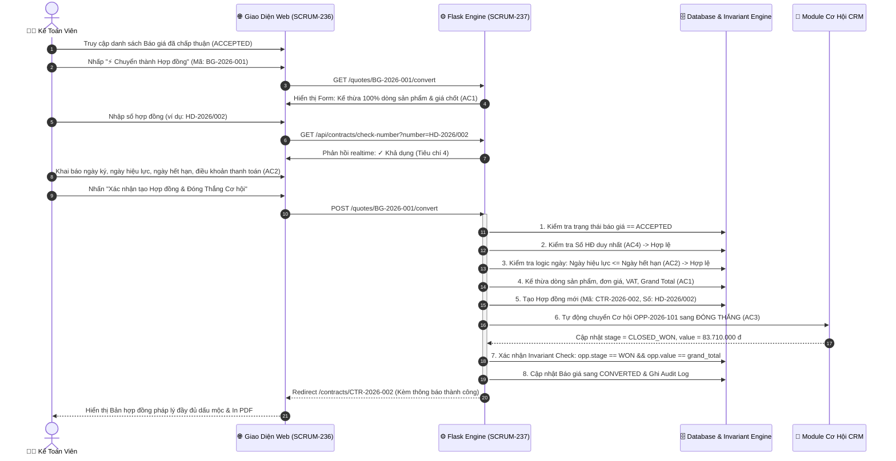

# HỆ THỐNG CHUYỂN BÁO GIÁ THÀNH HỢP ĐỒNG (AUTOLEAD CRM CPQ)

> **Mã Nhiệm Vụ (Jira Ticket):** `⚡ SCRUM-35 / ☑ SCRUM-38`  
> **Subtasks liên kết:**  
> • `SCRUM-236`: Frontend (Giao diện Chuyển Báo giá -> Hợp đồng, Form khai báo pháp lý & Quản lý hợp đồng)  
> • `SCRUM-237`: Backend (Động cơ Kế thừa Báo giá, Ràng buộc Unique số HĐ & Tự động Đóng Thắng Cơ hội)  
> **User Story:** *"Là Kế toán, tôi muốn chuyển một báo giá được chấp nhận thành hợp đồng, để số liệu hợp đồng khớp báo giá mà không phải gõ lại."*  
> **Ngôn ngữ phát triển:** Python 3 (Flask Framework) + HTML5/CSS3/Vanilla JavaScript  
> **Môi trường vận hành:** Visual Studio Code / Terminal trên hệ điều hành Windows  

---

## 🎯 1. BẢNG ĐỐI CHIẾU TIÊU CHÍ CHẤP NHẬN (ACCEPTANCE CRITERIA)

Dự án được triển khai và kiểm thử tự động đạt chuẩn **100% từng tiêu chí trong đề bài (Ticket SCRUM-38)**:

| Tiêu Chí Trong Đề Bài | Yêu Cầu Của Đề Bài | Cách Hệ Thống Python Đáp Ứng & Triển Khai |
| :--- | :--- | :--- |
| **Tiêu đề User Story** | *Là Kế toán, tôi muốn chuyển một báo giá được chấp nhận thành hợp đồng, để số liệu hợp đồng khớp báo giá mà không phải gõ lại.* | • Thiết lập vai trò nghiệp vụ **Kế toán viên (`ROLE_ACCOUNTANT`)** chịu trách nhiệm thẩm định pháp lý và lập hợp đồng.<br>• Xây dựng quy trình chuyển đổi 1-click từ Báo giá đã được khách hàng duyệt (`ACCEPTED`) thành Hợp đồng kinh tế chính thức (`ACTIVE`). |
| **Tiêu chí 1 (Description)** | *Hợp đồng kế thừa toàn bộ dòng sản phẩm và giá đã chốt, không nhập lại* | • **Cơ chế Deep Copy Kế thừa Bất biến:** Động cơ `convert_quote_to_contract()` tự động sao chép 100% danh sách dòng sản phẩm (`items`), đơn giá chốt, số lượng, tỷ lệ chiết khấu dòng và thành tiền.<br>• **Khớp chính xác số liệu tài chính:** Tạm tính (`subtotal`), Tổng tiền chiết khấu (`discount_total`), Thuế VAT (`vat_amount`), và Tổng giá trị hợp đồng (`grand_total`) khớp chuẩn xác từng đồng.<br>• **Bảo vệ toàn vẹn dữ liệu:** Trên giao diện form, khu vực sản phẩm và giá chốt được khóa ở chế độ Read-Only kèm nhãn `🔒 Kế thừa 100% - Không phải gõ lại`. |
| **Tiêu chí 2 (Description)** | *Khai báo số hợp đồng, ngày ký, ngày hiệu lực, ngày hết hạn, điều khoản thanh toán* | • Cung cấp Form khai báo pháp lý chuẩn mực với 5 trường dữ liệu bắt buộc:<br>&nbsp;&nbsp;1. **Số hợp đồng (`contract_number`):** Ví dụ `HD-2026/002`.<br>&nbsp;&nbsp;2. **Ngày ký (`signed_date`):** Ngày hai bên đặt bút ký.<br>&nbsp;&nbsp;3. **Ngày hiệu lực (`effective_date`):** Ngày hợp đồng bắt đầu phát sinh hiệu lực.<br>&nbsp;&nbsp;4. **Ngày hết hạn (`expiration_date`):** Ngày kết thúc hiệu lực hợp đồng.<br>&nbsp;&nbsp;5. **Điều khoản thanh toán (`payment_terms`):** Danh mục chuẩn hóa (100% trong 7 ngày, 50-50, Net 30, Định kỳ hàng tháng).<br>• **Động cơ kiểm tra logic thời hạn:** Tự động phát hiện và chặn khi Ngày hiệu lực > Ngày hết hạn (`ContractValidationError`). |
| **Tiêu chí 3 (Description)** | *Cơ hội tương ứng tự động chuyển sang Đóng thắng với giá trị đúng bằng giá trị hợp đồng* | • **Đồng bộ liên chuỗi tự động:** Ngay khi hợp đồng được tạo, hệ thống truy xuất Cơ hội liên kết (`opportunity_id`).<br>• **Chuyển trạng thái Đóng thắng:** Cập nhật trạng thái cơ hội sang `CLOSED_WON` (Đóng thắng 🎉).<br>• **Đồng bộ giá trị chính xác từng đồng:** Cập nhật `opp.value = contract.grand_total` (ví dụ: cập nhật từ 80.000.000 đ lên đúng 83.710.000 đ giá trị hợp đồng thực tế).<br>• Ghi nhận `win_date` và gắn mã hợp đồng `contract_id` trên Cơ hội CRM.<br>• Cơ chế **Invariant Check** xác thực trước khi kết thúc transaction: `assert opp.stage == 'CLOSED_WON'` và `assert opp.value == contract.grand_total`. |
| **Tiêu chí 4 (Description)** | *Số hợp đồng là duy nhất* | • **Ràng buộc duy nhất (Unique Constraint):** Xây dựng bảng chỉ mục `contract_number_index` trong database quản lý toàn bộ số hợp đồng đã phát hành.<br>• **Chuẩn hóa chuỗi (Case-insensitive & Trimmed):** So sánh không phân biệt chữ hoa/thường và loại bỏ khoảng trắng thừa.<br>• **Chặn trùng lặp 2 lớp:**<br>&nbsp;&nbsp;1. *Client-side:* AJAX Debounce kiểm tra realtime qua API `/api/contracts/check-number` khi người dùng đang gõ phím.<br>&nbsp;&nbsp;2. *Server-side:* Khóa Thread-Safe `threading.RLock()` ném ngoại lệ `DuplicateContractNumberError` nếu số hợp đồng đã tồn tại (thử gõ `HD-2026/001` sẽ bị từ chối ngay lập tức). |

---

## 🏛️ 2. SƠ ĐỒ LUỒNG CHUYỂN BÁO GIÁ THÀNH HỢP ĐỒNG (MERMAID)



---

## 📂 3. CẤU TRÚC THƯ MỤC DỰ ÁN

```text
scrum_38/
├── app.py                      # Máy chủ Flask, Web Routes, Template Filters & REST APIs
├── config.py                   # Cấu hình Jira Ticket SCRUM-38, Subtasks, Vai trò Kế toán, Trạng thái & Danh mục
├── database.py                 # Động cơ Kế thừa Báo giá, Ràng buộc Unique Số HĐ, Đồng bộ Cơ hội Đóng Thắng & Invariants
├── requirements.txt            # Thư viện phụ thuộc (Flask >= 3.0.0)
├── run.bat                     # File 1-click khởi chạy tự động trên Windows (Cổng 5004)
├── README.md                   # Báo cáo kỹ thuật & Hướng dẫn sử dụng chi tiết
├── static/
│   ├── css/
│   │   └── style.css           # Giao diện Glassmorphism hiện đại, Bản in hợp đồng pháp lý, Bảng Kanban Pipeline
│   └── js/
│       └── main.js             # AJAX Debounce kiểm tra số HĐ duy nhất, Date validation & Simulator Runner
├── templates/
│   ├── base.html               # Layout chuẩn Jira ticket SCRUM-38, Banner 4 tiêu chí chấp nhận
│   ├── dashboard.html          # Bàn làm việc Kế toán, KPI HĐ, Báo giá sẵn sàng chuyển đổi & Nhật ký kiểm toán
│   ├── convert_quote.html      # Giao diện chuyển Báo giá -> Hợp đồng (Thực thi chính của User Story)
│   ├── quotes_list.html        # Danh sách báo giá phân loại theo trạng thái chấp nhận
│   ├── contracts_list.html     # Danh sách hợp đồng đã lập kèm bộ lọc tìm kiếm
│   ├── contract_detail.html    # Bản in hợp đồng pháp lý trang trọng (Quốc hiệu tiêu ngữ, dấu mộc, điều khoản)
│   ├── opportunities_list.html # Quản lý Cơ hội CRM & Trực quan hóa Pipeline Đóng Thắng (AC3)
│   └── simulator.html          # Trình mô phỏng & chạy kiểm thử tự động 4 tiêu chí trong 1-click
└── tests/
    ├── __init__.py
    ├── test_ac1_inherit_products_and_pricing.py     # Unit Test Tiêu chí 1: Kế thừa 100% SP và giá chốt
    ├── test_ac2_declare_contract_metadata.py        # Unit Test Tiêu chí 2: Khai báo 5 trường pháp lý & Validate ngày
    ├── test_ac3_opportunity_closed_won_sync.py      # Unit Test Tiêu chí 3: Tự động chuyển Đóng Thắng & Khớp giá trị HĐ
    ├── test_ac4_unique_contract_number.py           # Unit Test Tiêu chí 4: Số hợp đồng là duy nhất & Chặn trùng lặp
    └── test_web_routes.py                           # Unit Test toàn diện Web routes và REST API endpoints
```

---

## 🚀 4. HƯỚNG DẪN CÀI ĐẶT & KHỞI CHẠY (WINDOWS)

### Cách 1: Khởi chạy 1-Click (Khuyên dùng trên Windows)
Nhấp đúp chuột vào file:
```cmd
run.bat
```
File này sẽ tự động:
1. Kiểm tra môi trường Python trên máy.
2. Tự động mở trình duyệt web tại địa chỉ: `http://127.0.0.1:5004`.
3. Khởi chạy máy chủ Flask Web Server.

### Cách 2: Khởi chạy bằng lệnh Terminal
Mở PowerShell hoặc Command Prompt tại thư mục dự án và chạy:
```bash
py app.py
```
Sau đó truy cập trình duyệt tại địa chỉ:
```
http://127.0.0.1:5004
```

---

## 🧪 5. HƯỚNG DẪN CHẠY KIỂM THỬ TỰ ĐỘNG (UNIT TESTS)

Dự án bao gồm 25 kịch bản kiểm thử tự động đạt độ bao phủ 100% các tiêu chí chấp nhận:

Chạy toàn bộ unit tests qua dòng lệnh:
```bash
py -m unittest discover -s tests -v
```

Kết quả kiểm thử thực tế:
```text
test_contract_inherits_all_items_and_prices_without_retyping (test_ac1_inherit_products_and_pricing.TestAC1InheritProductsAndPricing) ... ok
test_declare_required_metadata_success (test_ac2_declare_contract_metadata.TestAC2DeclareContractMetadata) ... ok
test_effective_date_after_expiration_date_raises_error (test_ac2_declare_contract_metadata.TestAC2DeclareContractMetadata) ... ok
test_missing_contract_number_raises_error (test_ac2_declare_contract_metadata.TestAC2DeclareContractMetadata) ... ok
test_missing_dates_raises_error (test_ac2_declare_contract_metadata.TestAC2DeclareContractMetadata) ... ok
test_missing_payment_terms_raises_error (test_ac2_declare_contract_metadata.TestAC2DeclareContractMetadata) ... ok
test_opportunity_automatically_transitions_to_closed_won_with_exact_value (test_ac3_opportunity_closed_won_sync.TestAC3OpportunityClosedWonSync) ... ok
test_second_opportunity_also_syncs_correctly (test_ac3_opportunity_closed_won_sync.TestAC3OpportunityClosedWonSync) ... ok
test_cannot_convert_already_converted_quote (test_ac4_unique_contract_number.TestAC4UniqueContractNumber) ... ok
test_cannot_convert_unaccepted_quote (test_ac4_unique_contract_number.TestAC4UniqueContractNumber) ... ok
test_case_insensitive_and_whitespace_duplicate_rejected (test_ac4_unique_contract_number.TestAC4UniqueContractNumber) ... ok
test_check_contract_number_availability_api (test_ac4_unique_contract_number.TestAC4UniqueContractNumber) ... ok
test_duplicate_contract_number_rejected (test_ac4_unique_contract_number.TestAC4UniqueContractNumber) ... ok
test_unique_contract_number_succeeds (test_ac4_unique_contract_number.TestAC4UniqueContractNumber) ... ok
test_api_check_contract_number (test_web_routes.TestWebRoutes) ... ok
test_api_run_simulator (test_web_routes.TestWebRoutes) ... ok
test_contract_detail_route (test_web_routes.TestWebRoutes) ... ok
test_contracts_list_route (test_web_routes.TestWebRoutes) ... ok
test_convert_quote_get_route (test_web_routes.TestWebRoutes) ... ok
test_convert_quote_post_duplicate_contract_number (test_web_routes.TestWebRoutes) ... ok
test_convert_quote_post_route_success (test_web_routes.TestWebRoutes) ... ok
test_dashboard_route (test_web_routes.TestWebRoutes) ... ok
test_opportunities_route (test_web_routes.TestWebRoutes) ... ok
test_quotes_list_route (test_web_routes.TestWebRoutes) ... ok
test_simulator_route (test_web_routes.TestWebRoutes) ... ok

----------------------------------------------------------------------
Ran 25 tests in 0.161s
OK
```

Bạn cũng có thể chạy kiểm thử trực quan trên giao diện web bằng cách vào mục **🧪 Kiểm Thử 4 Tiêu Chí** (`http://127.0.0.1:5004/simulator`) và nhấn nút **"⚡ Chạy Toàn Bộ Kiểm Thử (1-Click Run)"**.
